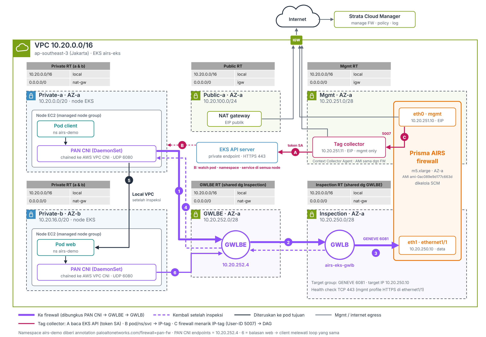

# Prisma AIRS + EKS (Jakarta): Firewall, GWLB, PAN CNI, and IP-Tag Collector

PoC lab in `ap-southeast-3`: one VPC with an EKS cluster, a **Prisma AIRS AI Runtime** firewall in a side subnet, a **GWLB + GWLB endpoint**, **PAN CNI** (CNI chaining) steering pod traffic to the firewall, and an **IP-tag collector** (Context Collector Agent) that sends Kubernetes tags to the firewall for Dynamic Address Groups.

> **No credentials in this repo.** `terraform.tfvars`, `tag-collector.auto.tfvars`, Terraform state, and the credential files created while following this README (`cred*.json`, `aws-cred*`) are excluded by `.gitignore`. Start from the `*.example` files.
>
> **Redaction.** Sensitive or tenant-specific values are written as placeholders: `<ACCOUNT_ID>`, `<TSG_ID>`, `<DISCOVERY_ACCOUNT_ID>`, `<OTID>`, `<EKS_ENDPOINT_HOST>`, `<FW_MGMT_EIP>`, `<TC_MGMT_EIP>`, `<NAT_EIP>`, `<VPCE_ID>`, `<ADMIN_IP>`. Auth codes, PINs, tokens, and the contents of `*.tfvars` are never written here. Put the real values in `terraform.tfvars` / `tag-collector.auto.tfvars` (do not commit them to a public repo).



---

## Table of contents

1. [Architecture](#1-architecture)
2. [Repository contents](#2-repository-contents)
3. [Prerequisites](#3-prerequisites)
4. [PANW discovery (cloud account onboarding)](#4-panw-discovery-cloud-account-onboarding)
5. [Infrastructure (Terraform)](#5-infrastructure-terraform)
6. [Prisma AIRS firewall](#6-prisma-airs-firewall)
7. [PAN CNI and traffic tests](#7-pan-cni-and-traffic-tests)
8. [IP-Tag Collector](#8-ip-tag-collector)
9. [Dynamic Address Groups (DAG)](#9-dynamic-address-groups-dag)
10. [Findings and limitations](#10-findings-and-limitations)
11. [Troubleshooting](#11-troubleshooting)
12. [Teardown / rollback](#12-teardown--rollback)
13. [References](#13-references)

---

## 1. Architecture

```
VPC 10.20.0.0/16 (ap-southeast-3)
│
├─ private-a 10.20.0.0/20 (AZ-a) ┐ EKS nodes (managed node group)
├─ private-b 10.20.16.0/20 (AZ-b)┘   Pod ─► AWS VPC CNI ─► pan-cni (chained, DaemonSet)
│                                                      │ to pan-ngfw-svc = GWLBE
│                                                      ▼
├─ gwlbe 10.20.252.0/28 (AZ-a)     GWLB endpoint 10.20.252.4
│                                                      │
├─ inspection 10.20.250.0/28 (AZ-a) GWLB ─GENEVE 6081─► FW eth1 = ethernet1/1 10.20.250.10
│
├─ mgmt 10.20.251.0/28 (AZ-a)      FW eth0 10.20.251.10 + EIP ─► SCM
│                                   Tag collector 10.20.251.11 + EIP
│                                     ├─ HTTPS 443 ─► EKS API (private endpoint, SA token)
│                                     └─◄ 5007 ── FW eth0 pulls IP-tags (User-ID redistribution)
│
└─ public-a/b 10.20.100.0/24, 10.20.101.0/24 (NAT GW, IGW)
```

| Component | Subnet / IP | Role |
|---|---|---|
| EKS nodes | private-a / private-b | Run pods. PAN CNI steers traffic from annotated namespaces |
| GWLB endpoint | `10.20.252.4` | Target of `pan-ngfw-svc` (PAN CNI endpoint) |
| GWLB | inspection | Forwards to the firewall over GENEVE 6081, health check TCP 443 |
| Firewall eth1 (`ethernet1/1`) | `10.20.250.10` | Data interface, terminates GENEVE |
| Firewall eth0 | `10.20.251.10` + `<FW_MGMT_EIP>` | Management, connection to SCM |
| Tag collector | `10.20.251.11` + `<TC_MGMT_EIP>` | Reads EKS, builds IP-tags, shares them with the firewall |

---

## 2. Repository contents

| File | Contents |
|---|---|
| `versions.tf`, `variables.tf`, `outputs.tf` | Providers, variables, outputs |
| `network.tf` | VPC, node/public subnets, NAT GW, inspection + mgmt subnets |
| `eks.tf` | EKS cluster, managed node group, node SG rules (all-port pod-to-pod, from the firewall) |
| `firewall.tf` | SGs, eth0/eth1 ENIs, mgmt EIP, firewall EC2 + bootstrap |
| `gwlb.tf` | GWLBE subnet, GWLB, GENEVE target group, endpoint service, GWLB endpoint |
| `pan-cni.tf` | PAN CNI Helm release (`endpoints` = GWLBE IP) |
| `tag-collector.tf` | Tag collector EC2, IAM (from the SCM template), EKS access entries, SG 443 to the EKS API and 5007 from the firewall |
| `tag-collector.auto.tfvars.example` | Example `tc_bootstrap_options` (copy to `tag-collector.auto.tfvars`, which git ignores) |
| `gwlb-test.tf` | Optional: test EC2 for regular GWLB traffic (route table) |
| `scp-helper.tf` | Optional: temporary EC2 used as the `scp import` source for the tag collector |
| `charts/ai-runtime-security/` | Official `PaloAltoNetworks/prisma-airs-helm` chart (MIT) |
| `k8s/airs-demo-all.yaml` | Demo: ns `airs-demo` + `airs-demo-b` (annotated), web :80, web2 :81, client |
| `k8s/test.sh` | 6 test scenarios, PASS/FAIL summary |
| `k8s/tag-collector-serviceaccount.yaml` | ServiceAccount + RBAC for the tag collector (PANW version + extra permissions) |
| `terraform.tfvars.example` | Example main variables (copy to `terraform.tfvars`, which git ignores) |
| `.gitignore` | Excludes state, real tfvars, credentials (`cred*.json`, `aws-cred*`, `*.pem`) |
| `docs/airs-eks-gwlb-tc.png` | HLD diagram |

---

## 3. Prerequisites

- [ ] Jakarta region (`ap-southeast-3`) enabled in the AWS account
- [ ] Prisma AIRS image subscribed in AWS Marketplace (`ami-0ac089e9d177c663d`, PAN-OS 12.2.3)
- [ ] EC2 key pair in `ap-southeast-3`
- [ ] Auth code (deployment profile) and Device Certificate PIN ID + value
- [ ] Strata Cloud Manager folder (example: `AIRS-EKS-Jakarta`)
- [ ] AWS cloud account onboarded in SCM (see section 4)
- [ ] Terraform ≥ 1.5, AWS CLI v2, kubectl, helm
- [ ] Your public IP for `admin_cidrs` (`<ADMIN_IP>/32`)

---

## 4. PANW discovery (cloud account onboarding)

### 4.0 AWS onboarding prerequisites (from the PANW docs)

Summary of *AWS Onboarding Prerequisites* and their status in this lab:

| Prerequisite | Purpose | Status in this lab |
|---|---|---|
| S3 bucket in the same region as the AI models | Destination for VPC flow logs and Bedrock logs | Outside this Terraform, prepare it if needed |
| VPC Flow Logs for the application subnet to S3 (custom format, all standard attributes, 1-hour partitions) | Application traffic discovery | Outside this Terraform |
| Bedrock model invocation logging to S3 | Model usage discovery | Only if Bedrock is used |
| EKS **Cluster authentication mode = EKS API and ConfigMap** | Container discovery | EKS module v20 default (`API_AND_CONFIG_MAP`). Check below |
| Public EKS endpoint allows the **PANW perimeter firewall IPs** for the tenant region | Container discovery from the PANW cloud | `eks_public_access_cidrs` default `0.0.0.0/0` already covers it. If you narrow it, add the PANW IPs from the docs page |
| EC2 IAM role with `bedrock:InvokeModel` | VMs calling models | Only if VMs call Bedrock |
| EKS Pod Identity association | Pods calling models | Only if pods call Bedrock |

Check the EKS authentication mode and endpoint access:

```bash
aws eks describe-cluster --name airs-eks --region ap-southeast-3 \
  --query 'cluster.[accessConfig.authenticationMode,resourcesVpcConfig.endpointPublicAccess,resourcesVpcConfig.publicAccessCidrs]'
```

Expected: `API_AND_CONFIG_MAP`, `true`, and CIDRs that cover the PANW IPs (or `0.0.0.0/0`).

> The PANW perimeter IP list is not copied here because it can change. Take it from the docs page. The SCM tenant region is not always the same as the AWS region (this lab's tenant is `americas`).

### 4.1 What happens

When an AWS account is onboarded to SCM (Prisma AIRS → cloud discovery), PANW creates IAM roles in your account and uses them from the PANW cloud to discover resources, including EKS clusters.

Observed in CloudTrail:

| Role | Session | Calls | Frequency |
|---|---|---|---|
| `arn:aws:iam::<ACCOUNT_ID>:role/airs-aws-logs_ip_tag` | `cloud-ip-tag-k8s` | `eks:ListClusters`, `eks:DescribeCluster` | about every 15 minutes |

EKS access entry present for the onboarding role: `role/airs-aws-logs`. The `airs-aws-logs_ip_tag` role has **no** access entry.

### 4.2 Check it yourself

```bash
aws cloudtrail lookup-events --region ap-southeast-3 \
  --lookup-attributes AttributeKey=Username,AttributeValue=cloud-ip-tag-k8s --max-results 20 \
  --query 'Events[].[EventTime,EventName]' --output table

aws eks list-access-entries --cluster-name airs-eks --region ap-southeast-3 --output table
```

> Kubernetes API calls (listing pods, etc.) are not recorded in CloudTrail. Enable EKS audit logs to see them.

### 4.3 SCM "Context Collector Agent" template

SCM generates tag collector Terraform (`<alias>_AGENT_AWS_AP-SOUTHEAST-3_<id>`, `firewallType: Context Collector Agent`) with three projects: `tgw_project`, `tc_project`, `tc_iam_project`. These projects are **not** used directly. The relevant parts are adapted into `tag-collector.tf` (see section 8).

---

## 5. Infrastructure (Terraform)

### 5.1 Variables

```bash
cp terraform.tfvars.example terraform.tfvars
```

Fill in `admin_cidrs`, `ssh_key_name`, and `bootstrap_options` (`dgname`, `authcodes`, PIN). Git ignores this file.

| `bootstrap_options` key | Value | Notes |
|---|---|---|
| `panorama-server` | `cloud` | Managed by SCM |
| `dgname` | `AIRS-EKS-Jakarta` | SCM folder |
| `tplname` | `otid:<OTID>` | From SCM |
| `plugin-op-commands` | `advance-routing:enable` | Never `aws-gwlb-overlay-routing` (single-arm design) |
| `mgmt-interface-swap` | `disable` | eth0 = mgmt, eth1 = ethernet1/1 |
| `authcodes`, `vm-series-auto-registration-pin-id`, `-pin-value` | required | Checked by preconditions |

Other important variables: `enable_gwlb = true` (default), `eks_public_access_cidrs`, `install_pan_cni`, `cluster_id`.

### 5.2 Deploy

```bash
terraform init
terraform plan -out tfplan
terraform apply tfplan          # about 20–25 minutes
```

```bash
$(terraform output -raw kubeconfig_command)
```

```bash
terraform output pan_cni_endpoint      # must be the GWLBE IP (10.20.252.4)
terraform output fw_mgmt_public_ip
```

---

## 6. Prisma AIRS firewall

### 6.1 Wait for the firewall to appear in SCM

10–20 minutes after the instance starts. Check in SCM (Cloud Managed Devices) or over SSH:

```bash
ssh -i <key>.pem admin@<FW_MGMT_EIP>
```

```
show system bootstrap status
show panorama-status
```

### 6.2 Interfaces, zones, routing (SCM, folder `AIRS-EKS-Jakarta`)

Configuration proven to work (single-arm GWLB):

| Object | Value |
|---|---|
| `ethernet1/1` | Layer3, **DHCP client** (gets `10.20.250.10`), zone `LAN`, logical router `default` |
| Interface management profile | `healthcheck` with **HTTPS** (for the GWLB TCP 443 health check) |
| Logical router | `default` (advanced routing), default route from DHCP |
| Security policy | Unchanged for the PoC. Pod-to-pod traffic matches `intrazone-default` (allow) or a test rule |

Push Config, then check:

```
show interface ethernet1/1
```

### 6.3 GWLB plugin

```
request plugins vm_series aws gwlb inspect enable yes
```

```
request plugins vm_series aws gwlb overlay-routing enable no
```

```
show plugins vm_series aws gwlb
```

Expected: `GWLB enabled: True`, `Overlay Routing: False`.

> Overlay routing can turn back on after an SCM push if **Enable Overlay Routing** is checked in the SCM deployment workflow. Overlay routing is only for two-arm designs (egress through `eth1/2`). Check again after every push.

### 6.4 Subinterface per GWLB endpoint (experiment)

Steps tried:

1. Subinterface `ethernet1/1.10`: tag 10, zone `eks-sub` (example), LR `default`, **static dummy IPv4** `100.64.10.1/30` (DHCP gets no address because AWS does not serve VLANs).
2. Endpoint association (use the endpoint ID `vpce-...`, not `vpce-svc-...`):

```
request plugins vm_series aws gwlb associate vpc-endpoint <VPCE_ID> interface ethernet1/1.10
```

```
show plugins vm_series aws gwlb
```

Result:

| Traffic source through the same GWLBE | Zone on the firewall |
|---|---|
| Regular EC2, routed to the GWLBE by route table (`gwlb-test.tf`) | **`eks-sub`** (`ethernet1/1.10`) |
| EKS pods through PAN CNI (sending directly to the GWLBE IP) | **`LAN`** (`ethernet1/1`) |

Conclusion: vpce → subinterface association **works for regular GWLB traffic but is not applied to PAN CNI traffic** (counters `flow_rcv_geneve_fast_decap` / `flow_fwaas_*`, no vpce counters). Kubernetes traffic is segmented with DAGs instead (section 9). Escalated to PANW.

To remove the subinterface: disassociate first, remove `$LAN.10` from the Virtual Router, Logical Router, and zone, then delete the interface and push.

```
request plugins vm_series aws gwlb disassociate vpc-endpoint <VPCE_ID> interface ethernet1/1.10
```

---

## 7. PAN CNI and traffic tests

### 7.1 Validate PAN CNI

```bash
kubectl get pods -n kube-system -l k8s-app=pan-cni -o wide
```

```bash
kubectl get endpointslices -n kube-system | grep pan
```

```bash
helm get values ai-runtime-security -n kube-system
```

`endpoints` must be `10.20.252.4` (GWLBE). Chart values are set in `pan-cni.tf`; do not edit `charts/ai-runtime-security/values.yaml`. If you install manually with Helm, set `install_pan_cni = false` so it does not conflict with Terraform:

```bash
helm upgrade --install ai-runtime-security ./charts/ai-runtime-security -n kube-system \
  --set endpoints=10.20.252.4 --set fwtrustcidr=10.20.250.0/28 --set clusterid=1 --set deployTo=eks
```

### 7.2 Deploy the demo

```bash
kubectl apply -f k8s/airs-demo-all.yaml
```

```bash
kubectl get pods -n airs-demo -o wide
```

```bash
kubectl get pods -n airs-demo-b -o wide
```

### 7.3 Test

```bash
bash k8s/test.sh
```

Expected result: `Ringkasan: 15 PASS, 0 FAIL` (same and different namespace, ClusterIP / headless / pod IP, including cross-node).

Evidence that traffic goes through the firewall:

- Traffic log: `( port.dst eq 80 )` for web, `( port.dst eq 81 )` for web2
- Firewall CLI: `show session all filter destination-port 81`
- GENEVE traffic: `show counter global filter delta yes` (`flow_rcv_geneve_fast_decap` = `flow_tx_geneve_encap`)

---

## 8. IP-Tag Collector

The tag collector is a VM with the **same AMI as the firewall**, running in tag collector mode (`plugin-op-commands=tag_collector_mode_flag:enable`, `tplname=otid:<OTID>;label:CtxColl`). It reads pods/namespaces/services from EKS and shares IP-tags with the firewall through User-ID redistribution (port 5007).

### 8.1 Adapted from the SCM template

| SCM template | In this project |
|---|---|
| `tgw_project` (Transit Gateway) | **Not used**. The tag collector is in the same VPC as EKS |
| `tc_project`: new VPC `10.20.0.0/16`, IP `10.20.0.14` | Existing mgmt subnet, `10.20.251.11` + EIP (the template VPC would overlap) |
| `tc_project`: SG 443/22 from `0.0.0.0/0` | Restricted to `admin_cidrs`; 5007 added from the firewall mgmt SG |
| `tc_iam_project`: `private_cluster_role` + `k8s-policy` | Same (names kept), plus EKS access entries with `AmazonEKSViewPolicy` |
| (none) | EKS cluster SG rule: 443 from the tag collector |

### 8.2 Bootstrap values

```bash
cp tag-collector.auto.tfvars.example tag-collector.auto.tfvars
```

Fill in `tc_bootstrap_options` and `tc_instance_role_name` from the SCM template (`tc_project/terraform.tfvars` and `tc_iam_project/terraform.tfvars`). Git ignores this file.

**Do not change** (tenant-specific): `tsg-id` (`<TSG_ID>`), `tplname`, `dgname`, `discovery-account-id` (`<DISCOVERY_ACCOUNT_ID>`), `cluster-account-ids` (maps to `<ACCOUNT_ID>`), `ip-tag-svc-endpoint`, `cdl-region`.

**Must replace** (the template fills them with repeated-letter placeholders):

- `authcodes`
- `vm-series-auto-registration-pin-id` (36-character UUID)
- `vm-series-auto-registration-pin-value`

`vm-auth-key` can stay empty. `tplname` contains `;`, so the tag collector user_data is newline-separated.

### 8.3 Deploy

```bash
aws sts get-caller-identity
```

```bash
terraform plan  -var enable_tag_collector=true
```

```bash
terraform apply -var enable_tag_collector=true
```

```bash
terraform output tag_collector_mgmt_public_ip
```

Wait 10–15 minutes, then:

```bash
ssh -i <key>.pem admin@<TC_MGMT_EIP>
```

If a bootstrap value was wrong, fix the tfvars and recreate the VM:

```bash
terraform apply -var enable_tag_collector=true -replace='aws_instance.tc[0]'
```

### 8.4 ServiceAccount and credentials

Cluster credentials **must be a Kubernetes ServiceAccount token** (see 10.2).

```bash
kubectl apply -f k8s/tag-collector-serviceaccount.yaml
```

```bash
kubectl auth can-i watch nodes --as=system:serviceaccount:kube-system:pan-plugin-user
```

```bash
kubectl -n kube-system get secret pan-plugin-user-secret -o json > cred.json
gzip -c cred.json | base64 | tr -d '\n' | pbcopy
rm cred.json
```

This manifest is PANW's `charts/ai-runtime-security/plugin-serviceaccount.yaml` (not installed by Helm because it sits outside `templates/`) plus read-only permissions:

| Extra permission | Symptom without it |
|---|---|
| `serviceaccounts`, `namespaces`: get/list/watch | Polling `Failed to get service accounts. Invalid permissions.` |
| `nodes`, `endpoints`: get/watch | Watching stuck at `Initializing`, counters `node_cred_err` / `endpoint_cred_err` keep increasing |

EKS endpoint hostname (without `https://`):

```bash
aws eks describe-cluster --name airs-eks --region ap-southeast-3 \
  --query cluster.endpoint --output text | sed 's#https://##'
```

### 8.5 Register the cluster (tag collector CLI)

One attribute per line (the one-line version from the docs returns `Invalid syntax`):

```
configure
set deviceconfig plugins kubernetes setup cluster-credentials <cluster_name> api-server-address <EKS_ENDPOINT_HOST>
set deviceconfig plugins kubernetes setup cluster-credentials <cluster_name> cluster-type EKS
set deviceconfig plugins kubernetes setup cluster-credentials <cluster_name> cluster-credential-file service-account-cred <BASE64>
set deviceconfig plugins kubernetes setup cluster-credentials <cluster_name> labels no-labels
set deviceconfig plugins kubernetes monitoring-definition <mon_def_name> cluster-credentials <cluster_name>
set deviceconfig plugins kubernetes monitoring-definition <mon_def_name> enable yes
commit
exit
```

| Placeholder | Meaning | Suggested name | Example in this lab |
|---|---|---|---|
| `<cluster_name>` | Name of the cluster credential entry on the tag collector | **Use the real EKS cluster name** (Terraform variable `name`, the one used in `aws eks ... --name`) so it is easy to match | `airs-eks` |
| `<mon_def_name>` | Monitoring definition, i.e. the tag collector's monitoring definition for that EKS cluster (one per cluster). Any name works | `<cluster_name>-mon` | `airs-eks-mon` |
| `<EKS_ENDPOINT_HOST>` | EKS API server hostname without `https://`. This decides which cluster is read | from `aws eks describe-cluster` | |
| `<BASE64>` | `cred.json` (SA secret), gzipped then base64-encoded | from step 8.4 | |

```
show plugins kubernetes status
```

```
show plugins kubernetes counters
```

Target: Polling and Watching `Connected`, `*_cred_err` not increasing.

Force a new poll (after fixing RBAC):

```
configure
set deviceconfig plugins kubernetes monitoring-definition <mon_def_name> enable no
commit
set deviceconfig plugins kubernetes monitoring-definition <mon_def_name> enable yes
commit
```

Test the token from your laptop (`200` allowed, `403` RBAC missing, `401` token rejected):

```bash
EP=$(aws eks describe-cluster --name airs-eks --region ap-southeast-3 --query cluster.endpoint --output text)
TOKEN=$(kubectl -n kube-system get secret pan-plugin-user-secret -o jsonpath='{.data.token}' | base64 -d)
for p in /api/v1/pods /api/v1/serviceaccounts /api/v1/namespaces; do
  echo "$p -> $(curl -sk -o /dev/null -w '%{http_code}' -H "Authorization: Bearer $TOKEN" $EP$p)"
done
unset TOKEN
```

> If the cluster is recreated, the hostname and token change: re-apply the ServiceAccount, rebuild `cred.json`, and update the credentials on the tag collector.

### 8.6 Redistribution to the firewall (SCM)

**Identity Services → Identity Redistribution → Add Agent**, scope `AIRS-EKS-Jakarta`:

| Field | Value |
|---|---|
| Name | `airs-eks-tag-collector` |
| Enabled | yes |
| Host | `10.20.251.11` |
| Port | `5007` |
| Data Type | **IP to Tag** |
| Collector Name / Pre-Shared Key | empty (PoC) |

Push Config. Check on the tag collector:

```
show redistribution service client all
```

Expected: `10.20.251.10/<port>  ...  T` (the firewall as an IP-tag client).

If empty: check `show user user-id-agent state all` on the firewall, and enable the User-ID service on the tag collector mgmt interface (`set deviceconfig system service disable-userid-service no`; check the option name with `?`).

### 8.7 Verify tags on the firewall

```
show object registered-ip all
```

Pod IPs must appear with `k8s.*` tags.

---

## 9. Dynamic Address Groups (DAG)

SCM → **Objects → Address → Address Groups → Add**, scope `AIRS-EKS-Jakarta`:

1. Name `dag-ns-airs-demo`, Type **Dynamic**
2. **Edit Match Criteria → CIE tab**, search `airs-demo`, pick the namespace tag (not the `k8s.app.*` labels)
3. Repeat for `dag-ns-airs-demo-b`
4. Push Config

```
show object dynamic-address-group all
```

A DAG is only an object. Using it in a security rule (for example `airs-demo → airs-demo-b` port 81 allow) is a separate policy change. Sessions through a ClusterIP are also logged against the Service IP, so include the Service tag (`k8s.svc*`) when needed.

### 9.1 Tag identifiers available

Tags seen in `show object registered-ip all` (25 registered addresses in this lab; full output in 9.3). Each object type has a short form and a cluster-qualified form.

`<cluster>` in the tags is the `<cluster_name>` of the cluster credential entry on the tag collector (8.5), not a value read from EKS. The tags say `cl_airs-eks` because the entry was created with `airs-eks` as `<cluster_name>`:

```
set deviceconfig plugins kubernetes setup cluster-credentials <cluster_name> api-server-address <EKS_ENDPOINT_HOST>
set deviceconfig plugins kubernetes setup cluster-credentials <cluster_name> cluster-type EKS
set deviceconfig plugins kubernetes setup cluster-credentials <cluster_name> cluster-credential-file service-account-cred <BASE64>
set deviceconfig plugins kubernetes setup cluster-credentials <cluster_name> labels no-labels
```

A different `<cluster_name>` there would change every `k8s.cl_<cluster>...` tag, and any DAG matching the old name would go empty.

| Object | Short form | Fully qualified form | Example in this lab |
|---|---|---|---|
| Cluster | `k8s.cl_<cluster>` | (same) | `k8s.cl_airs-eks` |
| Nodes | `k8s.nodes` | `k8s.cl_<cluster>.nodes` | `k8s.cl_airs-eks.nodes` |
| Namespace | `k8s.ns_<namespace>` | `k8s.cl_<cluster>.ns_<namespace>` | `k8s.cl_airs-eks.ns_airs-demo` |
| Service | `k8s.svc_<service>` | `k8s.cl_<cluster>.ns_<namespace>.svc_<service>` | `k8s.cl_airs-eks.ns_airs-demo.svc_web` |
| ReplicaSet | `k8s.rs_<replicaset>` | `k8s.cl_<cluster>.ns_<namespace>.rs_<replicaset>` | `k8s.cl_airs-eks.ns_airs-demo.rs_client-695cfc84f4` |
| DaemonSet | `k8s.ds_<daemonset>` | `k8s.cl_<cluster>.ns_<namespace>.ds_<daemonset>` | `k8s.cl_airs-eks.ns_kube-system.ds_kube-proxy` |

Notes for DAG match criteria:

- **Prefer the fully qualified form.** `k8s.svc_web` matches a service named `web` in any namespace or cluster the tag collector monitors. `k8s.cl_airs-eks.ns_airs-demo.svc_web` matches only that one.
- **A service tag covers the ClusterIP and the backing pods.** `svc_web` is on `172.20.60.163` (ClusterIP) and on the four web pods.
- **A namespace tag covers everything in the namespace**: all pods plus the Service ClusterIPs.
- **`k8s.cl_<cluster>` alone is only on pods and nodes.** Service ClusterIPs (`172.20.x.x`) do not carry it.
- **ReplicaSet tags are not stable.** The suffix (`695cfc84f4`) is the pod-template hash and changes when the Deployment is updated, which empties the DAG.
- **Pods without a Service have no service tag.** The `client` pods only carry the namespace and `rs_client-<hash>` tags. For a stable identifier, create a Service that selects them so they get a `svc_client` tag.
- **No label tags.** The cluster is registered with `labels no-labels` (8.5), so only the object types above are produced.

### 9.2 Namespace tag vs service tag

`k8s.ns_airs-demo` and `k8s.cl_airs-eks.ns_airs-demo.svc_web` differ in scope:

| IP | What | `k8s.ns_airs-demo` | `k8s.cl_airs-eks.ns_airs-demo.svc_web` |
|---|---|---|---|
| `172.20.60.163` | ClusterIP of service `web` | ✓ | ✓ |
| `10.20.2.108` | web pod | ✓ | ✓ |
| `10.20.30.225` | web pod | ✓ | ✓ |
| `10.20.7.25` | web pod | ✓ | ✓ |
| `10.20.28.139` | web pod | ✓ | ✓ |
| `10.20.20.112` | client pod | ✓ | ✗ |
| `10.20.3.66` | client pod | ✓ | ✗ |

1. **Object level.** The namespace tag holds 7 IPs (web + client), the service tag 5 (the `web` ClusterIP and its pods). A new workload in `airs-demo` joins the namespace tag automatically, but not `svc_web`.
2. **Cluster qualification.** `k8s.ns_airs-demo` is the short form, so a namespace `airs-demo` in another monitored cluster also matches. The cluster-bound equivalent is `k8s.cl_airs-eks.ns_airs-demo`.

Use the service tag as the destination for rules about access to the web application. Use the namespace tag for rules that apply to the whole namespace (for example limiting egress from `airs-demo`). Do not use the namespace tag as the destination of a "to web" rule, because the client pods would be allowed as destinations too.

### 9.3 Full output of `show object registered-ip all`

Taken on the tag collector (`10.20.251.11`). The firewall shows the same tags once redistribution works (8.7).

```
admin@ip-10-20-251-11> show object registered-ip all

registered IP                             Tags
----------------------------------------  -----------------

10.20.10.120 #
                                         "k8s.ds_aws-node (never expire)"
                                         "k8s.ds_eks-pod-identity-agent (never expire)"
                                         "k8s.cl_airs-eks.ns_kube-system.ds_kube-proxy (never expire)"
                                         "k8s.ds_kube-proxy (never expire)"
                                         "k8s.cl_airs-eks.ns_kube-system (never expire)"
                                         "k8s.cl_airs-eks (never expire)"
                                         "k8s.ns_kube-system (never expire)"
                                         "k8s.nodes (never expire)"
                                         "k8s.cl_airs-eks.nodes (never expire)"
                                         "k8s.ds_pan-cni (never expire)"
                                         "k8s.cl_airs-eks.ns_kube-system.ds_pan-cni (never expire)"
                                         "k8s.cl_airs-eks.ns_kube-system.ds_aws-node (never expire)"
                                         "k8s.cl_airs-eks.ns_kube-system.ds_eks-pod-identity-agent (never expire)"

172.20.0.1 #
                                         "k8s.cl_airs-eks.ns_default.svc_kubernetes (never expire)"
                                         "k8s.ns_default (never expire)"
                                         "k8s.svc_kubernetes (never expire)"
                                         "k8s.cl_airs-eks.ns_default (never expire)"

172.20.60.163 #
                                         "k8s.svc_web (never expire)"
                                         "k8s.cl_airs-eks.ns_airs-demo.svc_web (never expire)"
                                         "k8s.ns_airs-demo (never expire)"
                                         "k8s.cl_airs-eks.ns_airs-demo (never expire)"

10.20.0.246 #
                                         "k8s.cl_airs-eks.ns_default.svc_kubernetes (never expire)"
                                         "k8s.ns_default (never expire)"
                                         "k8s.svc_kubernetes (never expire)"

10.20.29.128 #
                                         "k8s.cl_airs-eks.ns_airs-demo-b.svc_web2 (never expire)"
                                         "k8s.cl_airs-eks.ns_airs-demo-b.rs_web2-6ddcbd6d8f (never expire)"
                                         "k8s.svc_web2 (never expire)"
                                         "k8s.cl_airs-eks (never expire)"
                                         "k8s.cl_airs-eks.ns_airs-demo-b (never expire)"
                                         "k8s.ns_airs-demo-b (never expire)"
                                         "k8s.rs_web2-6ddcbd6d8f (never expire)"
                                         "k8s.cl_airs-eks.ns_airs-demo-b.svc_web2-direct (never expire)"
                                         "k8s.svc_web2-direct (never expire)"

172.20.8.105 #
                                         "k8s.cl_airs-eks.ns_kube-system (never expire)"
                                         "k8s.cl_airs-eks.ns_kube-system.svc_eks-extension-metrics-api (never expire)"
                                         "k8s.ns_kube-system (never expire)"
                                         "k8s.svc_eks-extension-metrics-api (never expire)"

10.20.4.11 #
                                         "k8s.ds_aws-node (never expire)"
                                         "k8s.ds_eks-pod-identity-agent (never expire)"
                                         "k8s.cl_airs-eks.ns_kube-system.ds_kube-proxy (never expire)"
                                         "k8s.ds_kube-proxy (never expire)"
                                         "k8s.cl_airs-eks.ns_kube-system (never expire)"
                                         "k8s.cl_airs-eks (never expire)"
                                         "k8s.ns_kube-system (never expire)"
                                         "k8s.nodes (never expire)"
                                         "k8s.cl_airs-eks.nodes (never expire)"
                                         "k8s.ds_pan-cni (never expire)"
                                         "k8s.cl_airs-eks.ns_kube-system.ds_pan-cni (never expire)"
                                         "k8s.cl_airs-eks.ns_kube-system.ds_aws-node (never expire)"
                                         "k8s.cl_airs-eks.ns_kube-system.ds_eks-pod-identity-agent (never expire)"

10.20.2.108 #
                                         "k8s.svc_web (never expire)"
                                         "k8s.rs_web-5646769568 (never expire)"
                                         "k8s.svc_web-direct (never expire)"
                                         "k8s.cl_airs-eks.ns_airs-demo.svc_web (never expire)"
                                         "k8s.cl_airs-eks.ns_airs-demo.svc_web-direct (never expire)"
                                         "k8s.cl_airs-eks (never expire)"
                                         "k8s.cl_airs-eks.ns_airs-demo.rs_web-5646769568 (never expire)"
                                         "k8s.ns_airs-demo (never expire)"
                                         "k8s.cl_airs-eks.ns_airs-demo (never expire)"

10.20.15.11 #
                                         "k8s.cl_airs-eks.ns_airs-demo-b.svc_web2 (never expire)"
                                         "k8s.cl_airs-eks.ns_airs-demo-b.rs_web2-6ddcbd6d8f (never expire)"
                                         "k8s.svc_web2 (never expire)"
                                         "k8s.cl_airs-eks (never expire)"
                                         "k8s.cl_airs-eks.ns_airs-demo-b (never expire)"
                                         "k8s.ns_airs-demo-b (never expire)"
                                         "k8s.rs_web2-6ddcbd6d8f (never expire)"
                                         "k8s.cl_airs-eks.ns_airs-demo-b.svc_web2-direct (never expire)"
                                         "k8s.svc_web2-direct (never expire)"

172.0.32.0 #
                                         "k8s.cl_airs-eks.ns_kube-system.svc_eks-extension-metrics-api (never expire)"
                                         "k8s.ns_kube-system (never expire)"
                                         "k8s.svc_eks-extension-metrics-api (never expire)"

10.20.30.225 #
                                         "k8s.svc_web (never expire)"
                                         "k8s.rs_web-5646769568 (never expire)"
                                         "k8s.svc_web-direct (never expire)"
                                         "k8s.cl_airs-eks.ns_airs-demo.svc_web (never expire)"
                                         "k8s.cl_airs-eks.ns_airs-demo.svc_web-direct (never expire)"
                                         "k8s.cl_airs-eks (never expire)"
                                         "k8s.cl_airs-eks.ns_airs-demo.rs_web-5646769568 (never expire)"
                                         "k8s.ns_airs-demo (never expire)"
                                         "k8s.cl_airs-eks.ns_airs-demo (never expire)"

172.20.0.10 #
                                         "k8s.cl_airs-eks.ns_kube-system (never expire)"
                                         "k8s.ns_kube-system (never expire)"
                                         "k8s.svc_kube-dns (never expire)"
                                         "k8s.cl_airs-eks.ns_kube-system.svc_kube-dns (never expire)"

10.20.20.112 #
                                         "k8s.rs_client-695cfc84f4 (never expire)"
                                         "k8s.cl_airs-eks (never expire)"
                                         "k8s.ns_airs-demo (never expire)"
                                         "k8s.cl_airs-eks.ns_airs-demo (never expire)"
                                         "k8s.cl_airs-eks.ns_airs-demo.rs_client-695cfc84f4 (never expire)"

10.20.6.250 #
                                         "k8s.rs_coredns-69fc576bc8 (never expire)"
                                         "k8s.cl_airs-eks.ns_kube-system.rs_coredns-69fc576bc8 (never expire)"
                                         "k8s.cl_airs-eks.ns_kube-system (never expire)"
                                         "k8s.cl_airs-eks (never expire)"
                                         "k8s.ns_kube-system (never expire)"
                                         "k8s.svc_kube-dns (never expire)"
                                         "k8s.cl_airs-eks.ns_kube-system.svc_kube-dns (never expire)"

10.20.29.160 #
                                         "k8s.rs_coredns-69fc576bc8 (never expire)"
                                         "k8s.cl_airs-eks.ns_kube-system.rs_coredns-69fc576bc8 (never expire)"
                                         "k8s.cl_airs-eks.ns_kube-system (never expire)"
                                         "k8s.cl_airs-eks (never expire)"
                                         "k8s.ns_kube-system (never expire)"
                                         "k8s.svc_kube-dns (never expire)"
                                         "k8s.cl_airs-eks.ns_kube-system.svc_kube-dns (never expire)"

10.20.7.25 #
                                         "k8s.svc_web (never expire)"
                                         "k8s.rs_web-5646769568 (never expire)"
                                         "k8s.svc_web-direct (never expire)"
                                         "k8s.cl_airs-eks.ns_airs-demo.svc_web (never expire)"
                                         "k8s.cl_airs-eks.ns_airs-demo.svc_web-direct (never expire)"
                                         "k8s.cl_airs-eks (never expire)"
                                         "k8s.cl_airs-eks.ns_airs-demo.rs_web-5646769568 (never expire)"
                                         "k8s.ns_airs-demo (never expire)"
                                         "k8s.cl_airs-eks.ns_airs-demo (never expire)"

172.20.230.95 #
                                         "k8s.cl_airs-eks.ns_airs-demo-b.svc_web2 (never expire)"
                                         "k8s.svc_web2 (never expire)"
                                         "k8s.cl_airs-eks.ns_airs-demo-b (never expire)"
                                         "k8s.ns_airs-demo-b (never expire)"

10.20.29.119 #
                                         "k8s.rs_coredns-69fc576bc8 (never expire)"
                                         "k8s.cl_airs-eks.ns_kube-system.rs_coredns-69fc576bc8 (never expire)"
                                         "k8s.cl_airs-eks.ns_kube-system (never expire)"
                                         "k8s.cl_airs-eks (never expire)"
                                         "k8s.ns_kube-system (never expire)"
                                         "k8s.svc_kube-dns (never expire)"
                                         "k8s.cl_airs-eks.ns_kube-system.svc_kube-dns (never expire)"

10.20.28.139 #
                                         "k8s.svc_web (never expire)"
                                         "k8s.rs_web-5646769568 (never expire)"
                                         "k8s.svc_web-direct (never expire)"
                                         "k8s.cl_airs-eks.ns_airs-demo.svc_web (never expire)"
                                         "k8s.cl_airs-eks.ns_airs-demo.svc_web-direct (never expire)"
                                         "k8s.cl_airs-eks (never expire)"
                                         "k8s.cl_airs-eks.ns_airs-demo.rs_web-5646769568 (never expire)"
                                         "k8s.ns_airs-demo (never expire)"
                                         "k8s.cl_airs-eks.ns_airs-demo (never expire)"

10.20.0.193 #
                                         "k8s.rs_coredns-69fc576bc8 (never expire)"
                                         "k8s.cl_airs-eks.ns_kube-system.rs_coredns-69fc576bc8 (never expire)"
                                         "k8s.cl_airs-eks.ns_kube-system (never expire)"
                                         "k8s.cl_airs-eks (never expire)"
                                         "k8s.ns_kube-system (never expire)"
                                         "k8s.svc_kube-dns (never expire)"
                                         "k8s.cl_airs-eks.ns_kube-system.svc_kube-dns (never expire)"

10.20.29.252 #
                                         "k8s.cl_airs-eks.ns_default.svc_kubernetes (never expire)"
                                         "k8s.ns_default (never expire)"
                                         "k8s.svc_kubernetes (never expire)"

10.20.27.15 #
                                         "k8s.ds_aws-node (never expire)"
                                         "k8s.ds_eks-pod-identity-agent (never expire)"
                                         "k8s.cl_airs-eks.ns_kube-system.ds_kube-proxy (never expire)"
                                         "k8s.ds_kube-proxy (never expire)"
                                         "k8s.cl_airs-eks.ns_kube-system (never expire)"
                                         "k8s.cl_airs-eks (never expire)"
                                         "k8s.ns_kube-system (never expire)"
                                         "k8s.nodes (never expire)"
                                         "k8s.cl_airs-eks.nodes (never expire)"
                                         "k8s.ds_pan-cni (never expire)"
                                         "k8s.cl_airs-eks.ns_kube-system.ds_pan-cni (never expire)"
                                         "k8s.cl_airs-eks.ns_kube-system.ds_aws-node (never expire)"
                                         "k8s.cl_airs-eks.ns_kube-system.ds_eks-pod-identity-agent (never expire)"

10.20.3.66 #
                                         "k8s.rs_client-695cfc84f4 (never expire)"
                                         "k8s.cl_airs-eks (never expire)"
                                         "k8s.ns_airs-demo (never expire)"
                                         "k8s.cl_airs-eks.ns_airs-demo (never expire)"
                                         "k8s.cl_airs-eks.ns_airs-demo.rs_client-695cfc84f4 (never expire)"

10.20.30.1 #
                                         "k8s.ds_aws-node (never expire)"
                                         "k8s.ds_eks-pod-identity-agent (never expire)"
                                         "k8s.cl_airs-eks.ns_kube-system.ds_kube-proxy (never expire)"
                                         "k8s.ds_kube-proxy (never expire)"
                                         "k8s.cl_airs-eks.ns_kube-system (never expire)"
                                         "k8s.cl_airs-eks (never expire)"
                                         "k8s.ns_kube-system (never expire)"
                                         "k8s.nodes (never expire)"
                                         "k8s.cl_airs-eks.nodes (never expire)"
                                         "k8s.ds_pan-cni (never expire)"
                                         "k8s.cl_airs-eks.ns_kube-system.ds_pan-cni (never expire)"
                                         "k8s.cl_airs-eks.ns_kube-system.ds_aws-node (never expire)"
                                         "k8s.cl_airs-eks.ns_kube-system.ds_eks-pod-identity-agent (never expire)"

172.20.86.54 #
                                         "k8s.cl_airs-eks.ns_kube-system.svc_pan-ngfw-svc (never expire)"
                                         "k8s.cl_airs-eks.ns_kube-system (never expire)"
                                         "k8s.ns_kube-system (never expire)"
                                         "k8s.svc_pan-ngfw-svc (never expire)"

Total: 25 registered addresses
*: received from user-id agent  #: persistent  +: received from cloud
```

---

## 10. Findings and limitations

### 10.1 Subinterface/zone for PAN CNI traffic

GWLB endpoint → subinterface association does not apply to PAN CNI traffic (see 6.4). All pod traffic lands in the parent zone (`LAN`). Segmentation is done per tag (DAG), not per zone.

### 10.2 IAM role for the tag collector

Tried and **rejected** by the tag collector Kubernetes plugin (PAN-OS 12.2.3):

| Credential | Result |
|---|---|
| AWS file with `role_arn` + `credential_source=Ec2InstanceMetadata` (base64) | `File should be json containing Token and CA cert.` |
| AWS file with STS credentials from `private_cluster_role` | Rejected, same message |
| Secret-shaped JSON with an IAM-generated EKS token (`aws eks get-token`) | Rejected, same message |

The CLI only offers `service-account-cred` and `service-account-json`, and `scp import` only has the `k8s-service-account` type. `private_cluster_role` was never assumed (CloudTrail). So **the ServiceAccount token is the only working path**. The question of how `private_cluster_role` is meant to be used has been raised with PANW.

### 10.3 Other

- Single firewall in AZ-a: AZ-b nodes cross AZs (cost and latency). For HA, add a firewall per AZ to the GWLB target group.
- Fargate is not covered (PAN CNI is a DaemonSet).
- DLP configuration from SCM (`PII Basic Block All Data` → `DLP App Exclusion`) causes a validation error on the tag collector. Fix it in SCM if tag collector commits fail.

---

## 11. Troubleshooting

| Symptom | Check |
|---|---|
| `plan` fails at `data.aws_ami.fw` | AMI not in the region / Marketplace not subscribed |
| Firewall does not appear in SCM | `dgname`, auth code/PIN, mgmt internet access (EIP, route to IGW) |
| Helm/kubectl timeout to the EKS API | Your public IP is not in `eks_public_access_cidrs` |
| Cross-node pod traffic fails | Node SG rule `ingress_self_all` |
| GWLB target group unhealthy | HTTPS mgmt profile not attached to `ethernet1/1` |
| Traffic reaches the GWLB but no replies | `request plugins vm_series aws gwlb inspect enable yes` |
| Overlay routing `True` again after a push | Overlay option in SCM, turn it off again (6.3) |
| `associate ... should be less than or equal to 22 characters` | Use the endpoint ID `vpce-...`, not `vpce-svc-...` |
| Deleting a subinterface fails with `references from ... virtual-router` | Remove it from the Virtual Router, Logical Router, and zone first |
| Tag collector `Invalid permissions` | ServiceAccount RBAC (8.4), test with `curl` |
| Watching stays `Initializing` | `watch` on nodes/endpoints, check `show plugins kubernetes counters` |
| Redistribution client list empty | SG 5007, agent pushed from SCM, User-ID service on the tag collector |
| Tag collector commit fails after a test | Delete the failed candidate entries (`delete ...`) and commit |

---

## 12. Teardown / rollback

Stop inspection for one namespace:

```bash
kubectl annotate namespace airs-demo paloaltonetworks.com/firewall-
kubectl rollout restart deployment -n airs-demo
```

Remove the tag collector:

```bash
kubectl delete -f k8s/tag-collector-serviceaccount.yaml
terraform apply
```

Remove everything (workloads first, then infrastructure):

```bash
kubectl delete -f k8s/airs-demo-all.yaml
terraform destroy
```

After destroying, deactivate the firewall and tag collector licenses in SCM/CSP.

---

## 13. References

- Basics of Container Security (CNI chaining): https://docs.paloaltonetworks.com/prisma-airs/ai-runtime-security/airs-vm-firewall/microperimeter/cni-chaining-concept-overview
- Secure VMs and Kubernetes Clusters in AWS (SCM): https://docs.paloaltonetworks.com/prisma-airs/ai-inventory/scm-config-protect-vms-k8s-aws
- Deploy Prisma AIRS Network Intercept in AWS (overlay routing): https://docs.paloaltonetworks.com/prisma-airs/ai-runtime-security/airs-managed-saas-firewall/add-ai-instance-for-aws
- Associate a VPC Endpoint with a VM-Series Interface: https://docs.paloaltonetworks.com/vm-series/deployment/public-cloud/set-up-the-vm-series-firewall-on-aws/vm-series-integration-with-gateway-load-balancer/associate-a-vpc-endpoint-with-a-vm-series-interface
- AWS Onboarding Prerequisites: https://docs.paloaltonetworks.com/prisma-airs/ai-inventory/cloud-resource-discovery/onboard-and-activate-cloud-account-in-scm/aws-onboarding-prerequisites
- Deploy a Tag Collector Agent on AWS: https://docs.paloaltonetworks.com/prisma-airs/ai-inventory/cloud-resource-discovery/private-cluster-discovery/deploy-a-tag-collector-agent-to-secure-private-clusters
- Harvest IP-Tags from Kubernetes Clusters: https://docs.paloaltonetworks.com/prisma-airs/getting-started/use-case-harvesting-ip-tags-k8s-clusters
- Service accounts for cluster authentication (CN-Series): https://docs.paloaltonetworks.com/cn-series/getting-started/cn-series-deployment-prereq/create-service-accounts-for-cluster-authentication-with-cn-series
- VM-Series bootstrap parameters: https://docs.paloaltonetworks.com/vm-series/getting-started/bootstrap-the-vm-series-firewall/create-bootstrap-configuration-files
- Helm chart: https://github.com/PaloAltoNetworks/prisma-airs-helm

---

Tested by: [Rifky Ardiansyah](https://www.linkedin.com/in/rifkyardiansyah/)
